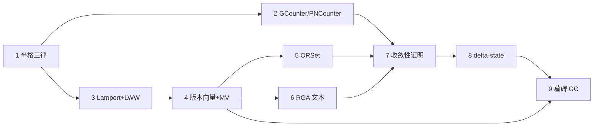

# CRDT 从 0 到 1：小白实操手册

> **一句话总纲**：CRDT 不是某种中间件，而是一种**数据类型的写法**——把"冲突解决"从一个需要协商的流程，压缩成一个**可交换、可重复、可乱序**的纯函数 `merge`。写对了 `merge`，分布式一致性就是免费的。

配套代码全部在本仓库 `src/main/java/crdt/` 下，**每一步都能自己动手跑**。全文的每一段"期望输出"、"会挂哪个测试"都是**实测结果**，不是推测。

---

## 怎么读（分阶段）

本手册拆成 11 个文件，**每步一个文件，独立可读**。按"总 → 分 → 总"三段推进：

| 阶段 | 文件 | 什么时候读 |
|---|---|---|
| **总** | 本页 + [快速开始](docs/00-快速开始.md) | 开工前一次性读完（环境、三个核心名词、每步的固定套路） |
| **分** | [第 1 步](docs/01-半格三律.md) → [第 9 步](docs/09-墓碑GC.md) | 一次只读一个文件，读完立刻动手写 + 跑测试 |
| **总** | [总结与自检](docs/99-总结与自检.md) | 9 步都做完后再读（一页纸总结、自检清单、常见误区、术语表） |

**每个步骤文件的固定结构**（约 100 行，30 分钟一轮）：

```
目标 → 大白话原理 → 你要写的 API → 硬性不变量 → 动手验证（可复制命令 + 期望输出）
     → 破坏性实验（改坏哪一行、实测挂哪几个测试）→ 自检问答
```

> 学习节奏建议：**一次只做一步**，做完必须看到那一步的 `OK (n tests)` 再往下走。卡住了再对照 `src/main/java/crdt/` 下的参考实现——**先写后看**，效果差 10 倍。

---

## 实现阶梯（点步骤名进入对应文件）

| 步骤 | 你会实现 | 解决的真实问题 | 产出文件 | 该步验证 |
|---|---|---|---|---|
| [**1** 半格三律](docs/01-半格三律.md) | 契约 + 三律 | 先立规矩：什么样的 merge 才算合格 | `CvRDT.java` | 纯接口，无测试 |
| [**2** 计数器](docs/02-计数器.md) | `GCounter` / `PNCounter` | 多机并发计数，不丢不重 | `GCounter.java`、`PNCounter.java` | `OK (10 tests)` |
| [**3** LWW 寄存器](docs/03-LWW寄存器.md) | `LamportClock` / `LWWRegister` | 多机同时改同一个值，谁赢 | `LamportClock.java`、`LWWRegister.java` | `OK (6 tests)` |
| [**4** 版本向量与 MV 寄存器](docs/04-版本向量与MV寄存器.md) | `VersionVector` / `MVRegister` | 并发写不想丢，两个值都留 | `VersionVector.java`、`MVRegister.java` | `OK (8 tests)` |
| [**5** ORSet](docs/05-ORSet.md) | `ORSet` | 多机同时增删同一个集合 | `ORSet.java` | `OK (13 tests)` |
| [**6** RGA 文本](docs/06-RGA文本.md) | `RGA` | 协同文本编辑（Google Docs 的核心） | `RGA.java` | `OK (16 tests)` |
| [**7** 收敛性证明](docs/07-收敛性证明.md) | 恶劣网络仿真 | 用"丢包 + 重复 + 乱序"证明前 6 步 | `ConvergenceTest.java` | `OK (13 tests)` |
| [**8** delta-state](docs/08-delta-state.md) | 增量同步 | 不再传全量，只传增量 | `DeltaGCounter.java`、`DeltaORSet.java` | `OK (29 tests)` |
| [**9** 墓碑 GC](docs/09-墓碑GC.md) | 因果稳定 + 回收 | 让内存不随历史无限膨胀 | `CausalStamp.java`、`CausalStability.java` | `OK (5 tests)` |
| **合计** | 12 个 CRDT 类 + 12 个测试类 | | | **`OK (100 tests)`** |

依赖关系（**严格按箭头顺序做**，后面的每一步都用到前面的概念）：



---

## 学习进度清单

- [ ] [00 快速开始：环境、概念与套路](docs/00-快速开始.md)
- [ ] [01 半格三律](docs/01-半格三律.md)
- [ ] [02 GCounter / PNCounter](docs/02-计数器.md)
- [ ] [03 LamportClock + LWWRegister](docs/03-LWW寄存器.md)
- [ ] [04 VersionVector + MVRegister](docs/04-版本向量与MV寄存器.md)
- [ ] [05 ORSet](docs/05-ORSet.md)
- [ ] [06 RGA 文本](docs/06-RGA文本.md)
- [ ] [07 收敛性证明](docs/07-收敛性证明.md)
- [ ] [08 delta-state](docs/08-delta-state.md)
- [ ] [09 墓碑 GC / 因果稳定](docs/09-墓碑GC.md)
- [ ] [99 总结与自检](docs/99-总结与自检.md)

---

## 三条命令（随时可用）

本仓库的 `mvn compile` 已经损坏（`java8/chap6` 编码错误、`com.sun.*` 内部包等历史遗留，与 CRDT 无关），**不要用 mvn 验证本模块**。用 `javac` + JUnit：

```bash
cd /Users/lizixuan/Documents/IdeaProjects/LeetCode

JAR="$HOME/.m2/repository/junit/junit/4.13.1/junit-4.13.1.jar:$HOME/.m2/repository/org/hamcrest/hamcrest-core/1.3/hamcrest-core-1.3.jar"

# 1) 编译整个 crdt 模块
rm -rf /tmp/crdt && mkdir -p /tmp/crdt
javac -encoding UTF-8 -d /tmp/crdt -cp "$JAR" src/main/java/crdt/*.java src/test/java/crdt/*.java

# 2) 跑全部测试（当前实测 100 个全绿）
java -cp "/tmp/crdt:$JAR" org.junit.runner.JUnitCore \
  crdt.GCounterTest crdt.PNCounterTest crdt.LWWRegisterTest crdt.MVRegisterTest \
  crdt.ORSetTest crdt.RGATest crdt.LatticeLawsTest crdt.ConvergenceTest \
  crdt.DeltaGCounterTest crdt.DeltaORSetTest crdt.DeltaSyncTest crdt.TombstoneGcTest

# 3) 跑可视化 demo（打印每一步的合并结果）
java -cp /tmp/crdt crdt.CrdtDemo
```

```
JUnit version 4.13.1
OK (100 tests)
```

> 每一步还有**更窄的编译命令**（只编译那一步需要的文件），写在对应步骤文件的"动手验证"里——那才是做练习时该用的。

---

**开始** → [快速开始：环境、概念与学习套路](docs/00-快速开始.md)
